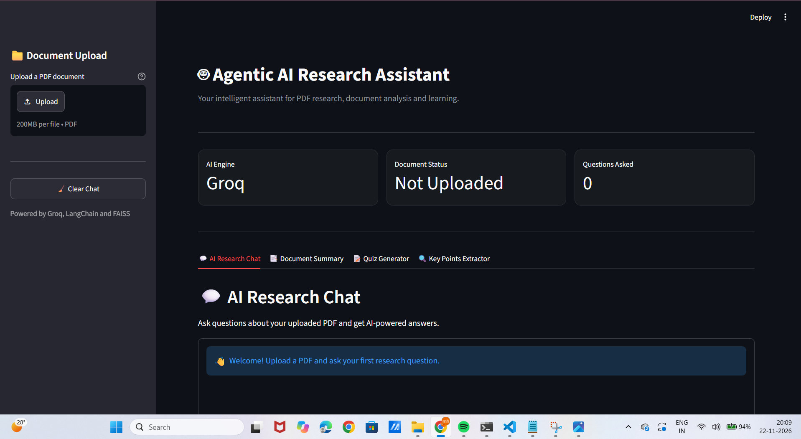
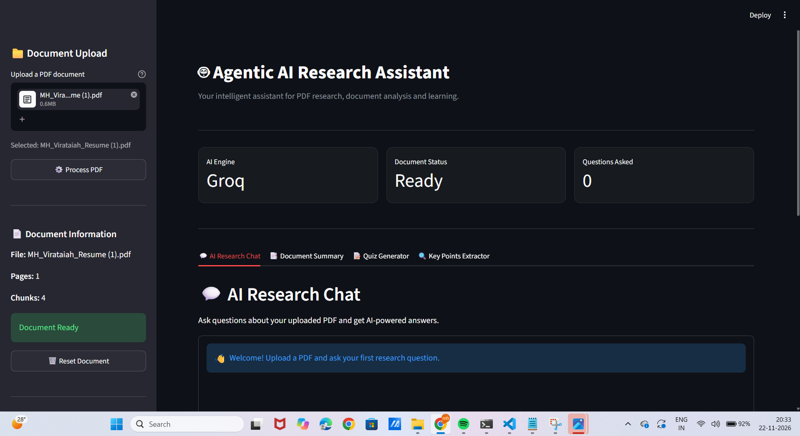
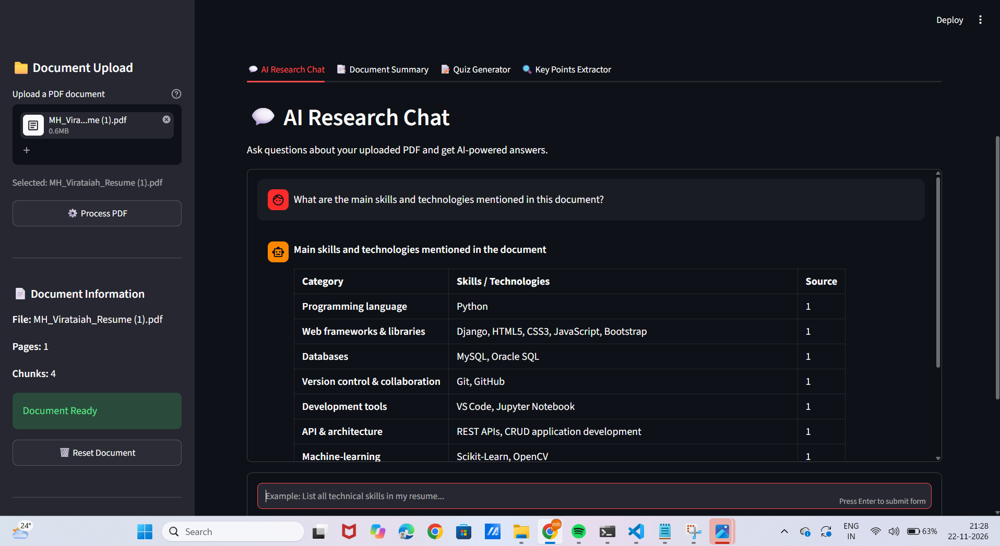

\# 🤖 Agentic AI Research Assistant


An AI-powered research assistant that helps users upload PDF documents, ask questions, generate summaries, create quizzes, and extract important information using Large Language Models (LLMs).


Powered by \*\*Groq, LangChain, FAISS, Hugging Face and Streamlit\*\*.


\## 🚀 Features


\- 📄 \*\*PDF Upload:\*\* Upload and process PDF documents.

\- 💬 \*\*AI Research Chat:\*\* Ask questions and receive answers based on uploaded documents.

\- 📑 \*\*Document Summary:\*\* Generate AI-powered document summaries.

\- 🧩 \*\*Quiz Generator:\*\* Automatically generate quizzes from PDF content.

\- 🎯 \*\*Key Points Extractor:\*\* Extract important information from documents.

\- 📊 \*\*Interactive Dashboard:\*\* View document status and processing information.

\- 🗂️ \*\*Vector Search:\*\* Retrieve relevant document content using FAISS.

\- 🔄 \*\*Document Reset:\*\* Clear uploaded document data and start a new research session.


## 📸 Application Screenshots

### 1. PDF Upload and AI Research Dashboard



### 2. PDF Document Ready



### 3. AI Research Chat



## 🛠️ Technologies Used

| Technology | Purpose |
|---|---|
| Python | Core programming language |
| Streamlit | User interface |
| Groq API | Large Language Model inference |
| LangChain | LLM application framework |
| FAISS | Vector database and similarity search |
| Hugging Face | Text embeddings |
| PyPDF | PDF text extraction |


\## 📁 Project Structure


```text

AgenticAI\_ResearchAssistant/

│

├── backend/

│   ├── app.py

│   ├── config.py

│   └── rag\_pipeline.py

│

├── screenshots/

│   ├── 01-pdf-upload.png

│   └── 02-document-ready.png

│

├── .gitignore

├── requirements.txt

└── README.md

```


\## ⚙️ Installation and Setup


\### 1. Clone the repository


```bash

git clone https://github.com/MHVirat21/AgenticAI-ResearchAssistant.git

cd AgenticAI-ResearchAssistant

```


\### 2. Create a virtual environment


```bash

python -m venv venv

```


\### 3. Activate the virtual environment


Windows PowerShell:


```powershell

.\\venv\\Scripts\\Activate.ps1

```


\### 4. Install dependencies


```bash

pip install -r requirements.txt

```


\### 5. Configure environment variables


Create a `.env` file in the project root directory.


Add your own Groq API key:


```env

GROQ\_API\_KEY=your\_groq\_api\_key

```


Never upload your `.env` file or API key to GitHub.


\### 6. Run the application


```bash

streamlit run backend/app.py

```


The application will open in your browser.


\## 🧠 How It Works


1\. User uploads a PDF document.

2\. The application extracts text from the PDF.

3\. Text is divided into smaller chunks.

4\. Hugging Face converts text chunks into embeddings.

5\. FAISS stores the embeddings for similarity search.

6\. LangChain retrieves relevant document content.

7\. Groq LLM generates answers based on the retrieved context.

8\. Users can also generate summaries, quizzes, and key points.


\## 👨‍💻 Author


\*\*M H Virataiah\*\*


AI \& Machine Learning Enthusiast | Python Developer


GitHub: \[MHVirat21](https://github.com/MHVirat21)


Portfolio: \[My Portfolio](https://mh-virataiah-portfolio.vercel.app)

